  
  
  

  <a href="https://dblabs.site">dblabs.site</a> ·
  <a href="mailto:contact@dblabs.site">contact@dblabs.site</a> ·
  <a href="https://www.linkedin.com/in/deniz-baran-ba63152b4/">LinkedIn</a> ·
  <a href="https://www.instagram.com/dblabs_official/">Instagram</a>

